# Healthcare Data Analysis (Final Project)

**Analyst:** Poleboina Kavya  
**Tools:** Python · pandas · NumPy · Matplotlib · Seaborn · scikit-learn · Google Colab

## Dataset Preview (First 5 Rows)
_Dataset embedded inside notebook._

## Output Visualizations
### Output Chart 1
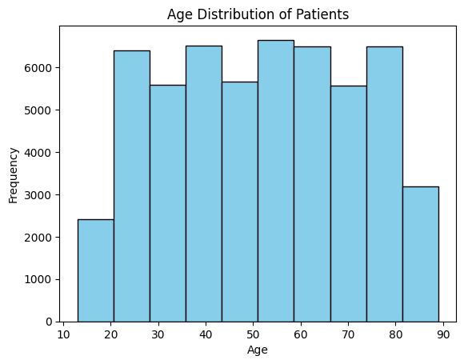

### Output Chart 2
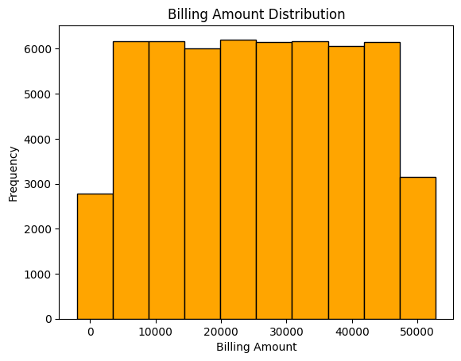

### Output Chart 3
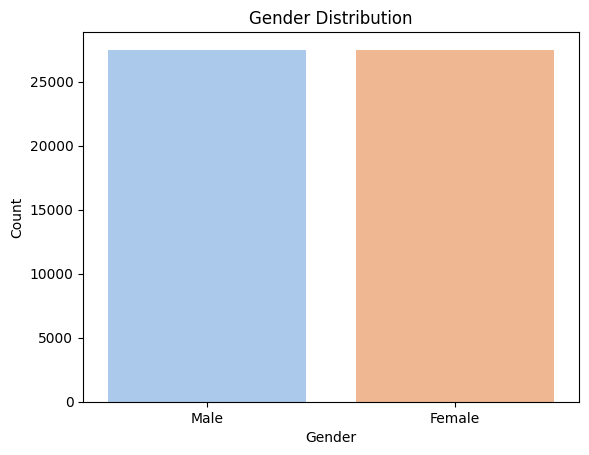

### Output Chart 4
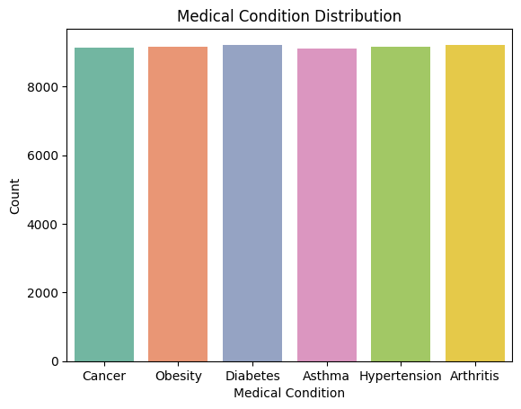

### Output Chart 5
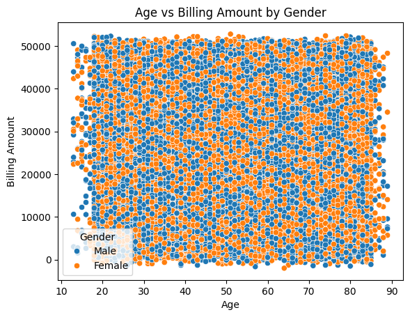

### Output Chart 6
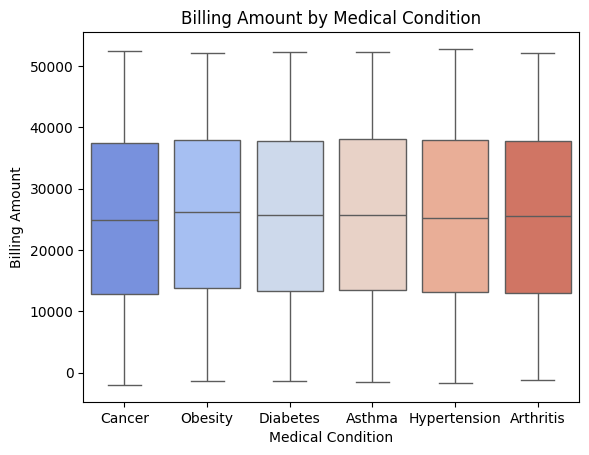

### Output Chart 7
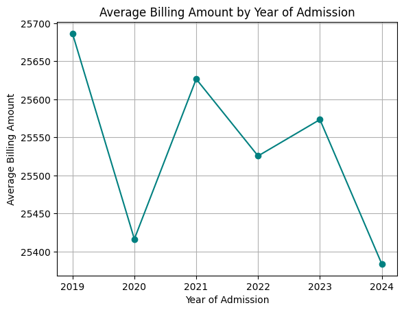

### Output Chart 8
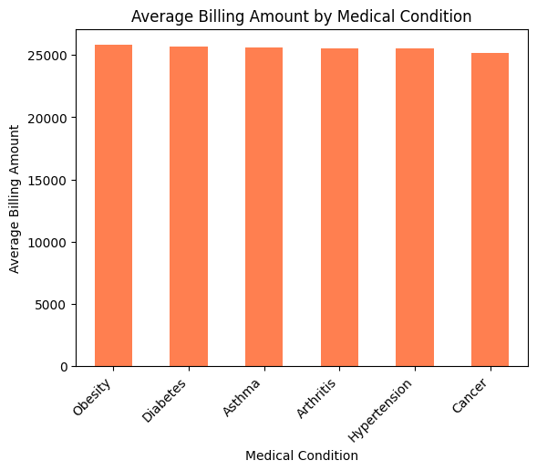

### Output Chart 9
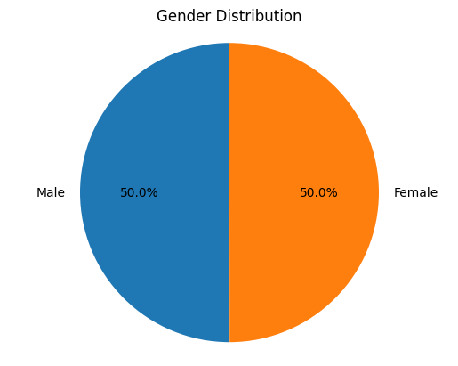

### Output Chart 10
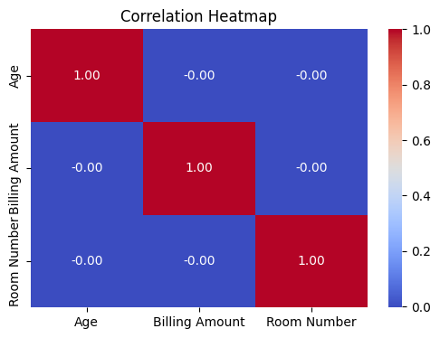

### Output Chart 11
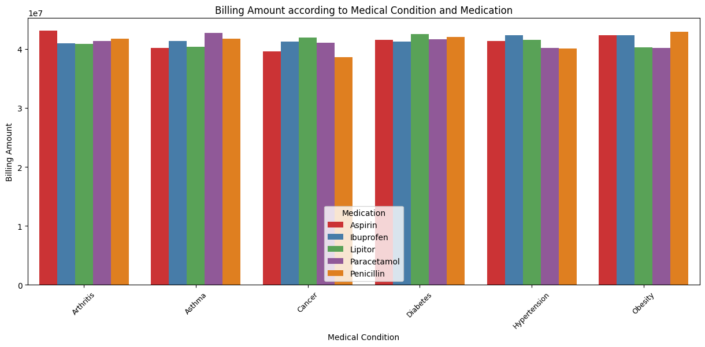
