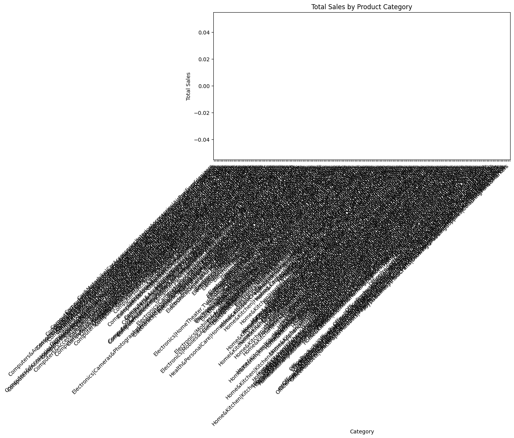
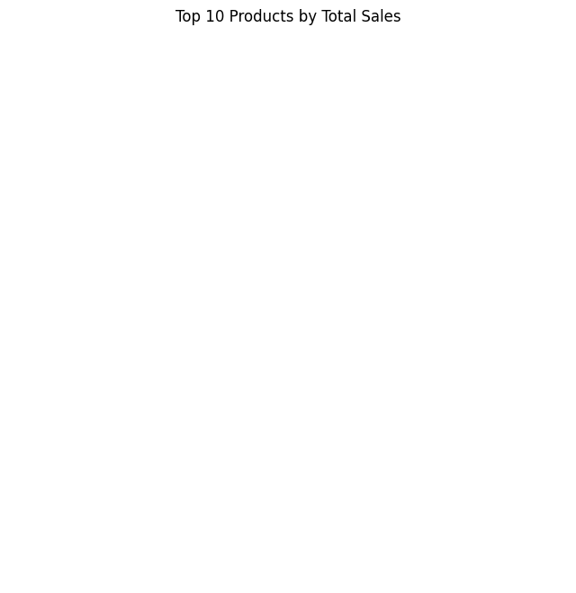
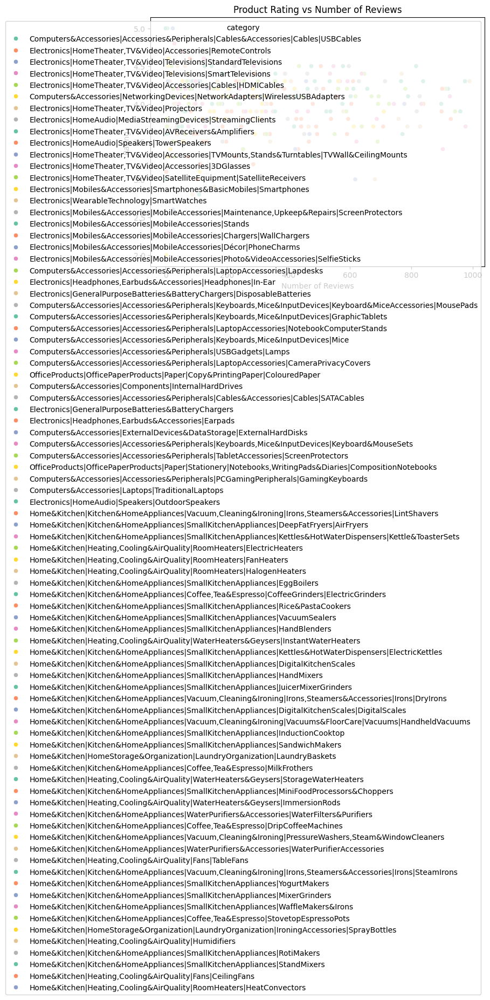
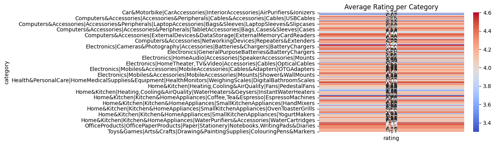

**#### Sales Analysis \& E-Commerce Dashboard**

**\*\*Data Analytics | Project 1\*\* | \*\*Analyst:\*\* Poleboina Kavya **

**#### Project overview**

**This project analyzes retail and Amazon e-commerce product performance to uncover revenue drivers, category rankings, discount impacts, and customer rating behavior. The notebook cleans raw pricing and rating strings, aggregates category-level sales metrics, and compiles a multi-chart visual dashboard with actionable business insights. **

**#### Dataset**

**\* \*\*Files:\*\* amazon.csv (1,465 products, 16 columns) \& data.zip (supplementary retail sales transactions)**

**\* \*\*Key Fields:\*\* product\_id, product\_name, category, discounted\_price, actual\_price, discount\_percentage, rating, rating\_count, review\_title, review\_content**

**#### Tech stack**

**Python, pandas, NumPy, Matplotlib, Seaborn, Google Colab / Jupyter Notebook **

**#### What the notebook does**

**StepWhat was done**

**\*\*1. Data cleaning\*\***

**Audited 1,465 rows (only 2 missing values, 0 duplicates), stripped currency/percentage symbols, and converted prices and ratings to numeric types**

**\*\*2. Data aggregation\*\***

**Grouped products by category to compute total sales, average discount percentages, and rating counts**

**\*\*3. Data visualizations\*\***

**Built comparative bar, scatter, and distribution plots examining pricing, discounts, and customer ratings**

**\*\*4. Dashboard\*\***

**Combined key KPI visuals into a unified Sales Analysis Dashboard**

**\*\*5. Insights preparation\*\***

**Extracted top-performing categories and summarized pricing/discount recommendations**

**#### Results: data quality \& summary**

**MeasureValue**

**\*\*Total Amazon product records\*\***

**1,465**

**\*\*Columns analyzed\*\***

**16**

**\*\*Missing values\*\***

**2 (handled during cleaning)**

**\*\*Duplicate rows\*\***

**0**

**\*\*Visualizations generated\*\***

**4 dashboard \& trend charts**

**#### Key decisions and why**

**\* \*\*Stripping formatting characters before aggregation:\*\* Raw price (₹) and discount (%) columns were stored as strings; converting them to floats was essential to avoid zero or string-concatenation errors during category sales rollups.**

**\* \*\*Zero-duplicate verification:\*\* Confirmed all 1,465 product rows were unique before computing category averages.**

**\* \*\*Pairing discount depth with rating count:\*\* Evaluated both discount percentage and review volume so high-discount, low-demand items do not distort top-category insights.**

**#### Screenshots**

**\*\*Chart 1 — Category Performance \& Sales Overview:\*\***

** **

**\*\*Chart 2 — Discount Percentage \& Pricing Distribution:\*\***

** **

**\*\*Chart 3 — Customer Ratings vs. Review Volume:\*\***

** **

**\*\*Chart 4 — Consolidated Sales Analysis Dashboard:\*\***

** **

**#### Files in this folder**

**\* Sales\_Analysis\_Dashboard.ipynb: complete notebook with cleaning, aggregation, and dashboard code**

**\* Sales Analysis Dashboard.ipynb - Colab.pdf: exported PDF report of the executed notebook**

**\* amazon.csv: Amazon product catalog and review dataset**

**\* data.zip: compressed retail sales dataset**

**\* screenshots/: extracted chart images (chart\_1.png – chart\_4.png)**

**#### How to run**

**1. Install the libraries: pip install pandas numpy matplotlib seaborn jupyter**

**2. Keep amazon.csv (and extract data.zip) in the same folder as Sales\_Analysis\_Dashboard.ipynb.**

**3. Open Sales\_Analysis\_Dashboard.ipynb in Jupyter Notebook or Google Colab and choose \*\*Run All\*\*.**

