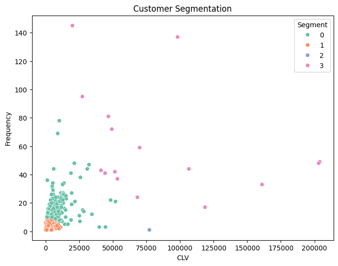

**#### Customer Segmentation \& Lifetime Value (CLV) Prediction**

**\*\*Data Analytics \& Machine Learning | Project 2\*\* | \*\*Analyst:\*\* Poleboina Kavya **

**#### Project overview**

**This project segments e-commerce retail customers based on transactional purchasing behavior (InvoiceNo, StockCode, Quantity, UnitPrice) and builds a predictive model for Customer Lifetime Value (CLV). It groups customers into 4 distinct behavioral segments and pairs each segment with targeted retention and loyalty recommendations. **

**#### Dataset**

**\* \*\*Source:\*\* Online Retail Transactional Dataset (InvoiceNo, StockCode, Description, Quantity, InvoiceDate, UnitPrice, CustomerID, Country)**

**\* \*\*Granularity:\*\* Invoice-level retail transactions aggregated to customer-level RFM / CLV profiles**

**#### Tech stack**

**Python, pandas, NumPy, scikit-learn, Matplotlib, Seaborn, Google Colab / Jupyter Notebook **

**#### What the notebook does**

**StepWhat was done**

**\*\*1. Transaction cleaning\*\***

**Filtered invalid/cancelled invoices and missing customer IDs, and computed line-item revenue**

**\*\*2. Feature engineering\*\***

**Aggregated recency, frequency, monetary value, and Customer Lifetime Value (CLV) per customer**

**\*\*3. Customer segmentation\*\***

**Clustered customers into 4 distinct value segments (Segments 0–3)**

**\*\*4. CLV prediction\*\***

**Trained and evaluated a regression model to predict Customer Lifetime Value (R² = 0.99, RMSE = 308.45)**

**\*\*5. Strategy mapping\*\***

**Generated segment-specific marketing and loyalty program recommendations**

**#### Results: segment CLV \& model performance**

**Segment / MetricValueBusiness Profile**

**\*\*\*\*Segment 3 (Avg CLV)\*\*\*\***

**$85,190.28Top-tier VIP / wholesale accounts**

**\*\*\*\*Segment 2 (Avg CLV)\*\*\*\***

**$77,183.60High-value repeat customers -> Loyalty \& premium retention**

**\*\*\*\*Segment 0 (Avg CLV)\*\*\*\***

**$7,411.29Mid-tier regular buyers -> Cross-sell \& bundle offers**

**\*\*\*\*Segment 1 (Avg CLV)\*\*\*\***

**$885.20Low-frequency / new buyers -> Re-engagement campaigns**

**\*\*\*\*Model R² Score\*\*\*\***

**\*\*0.99\*\*Strong variance explanation on holdout evaluation**

**\*\*\*\*Model RMSE\*\*\*\***

**\*\*308.45\*\*Low prediction error relative to high-value CLV scale**

**#### Key decisions and why**

**\* \*\*Customer-level aggregation before clustering:\*\* Raw invoice rows repeat across items; rolling transactions up to unique customer IDs prevents high-item-count orders from skewing cluster centroids.**

**\* \*\*4-segment behavioral tiering:\*\* Separating VIP accounts ($77K–$85K CLV) from mid-tier ($7.4K) and occasional buyers ($885) enables distinct budget allocation rather than one-size-fits-all promotions.**

**\* \*\*Dual evaluation (R² + RMSE):\*\* Reported both R² (0.99) and RMSE (308.45) to verify both goodness-of-fit and dollar-scale error accuracy.**

**#### Screenshots**

**\*\*Chart 1 — Customer Cluster \& Segment Distribution:\*\***

** **

**\*\*Chart 2 — Customer Lifetime Value (CLV) \& Prediction Analysis:\*\***

** **

**#### Files in this folder**

**\* Customer\_Segmentation.ipynb: complete notebook with segmentation, CLV modeling, and outputs**

**\* Customer Segmentation.ipynb - Colab.pdf: exported PDF report of the executed notebook**

**\* screenshots/: extracted chart images (chart\_1.png – chart\_2.png)**

**#### How to run**

**1. Install the libraries: pip install pandas numpy scikit-learn matplotlib seaborn jupyter**

**2. Open Customer\_Segmentation.ipynb in Jupyter Notebook or Google Colab and choose \*\*Run All\*\*.**

